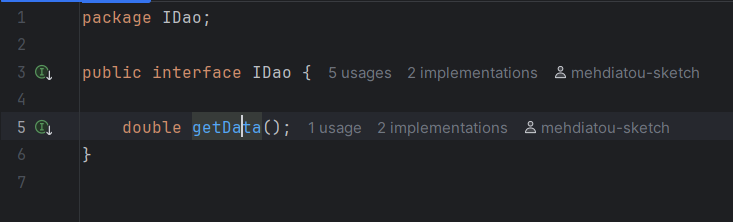
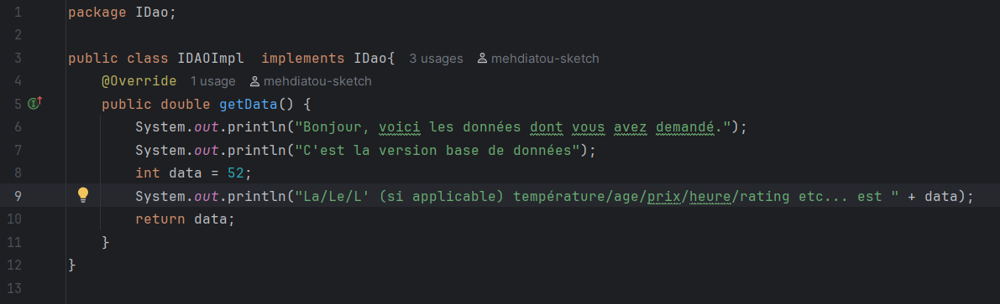
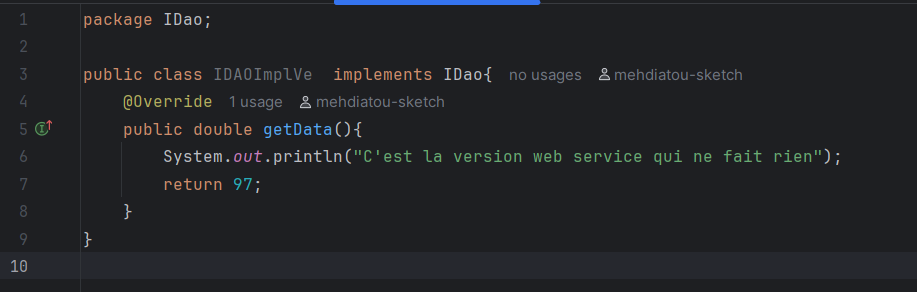
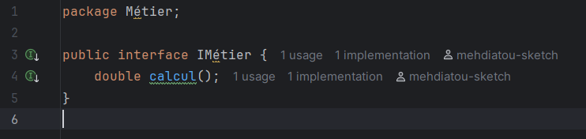
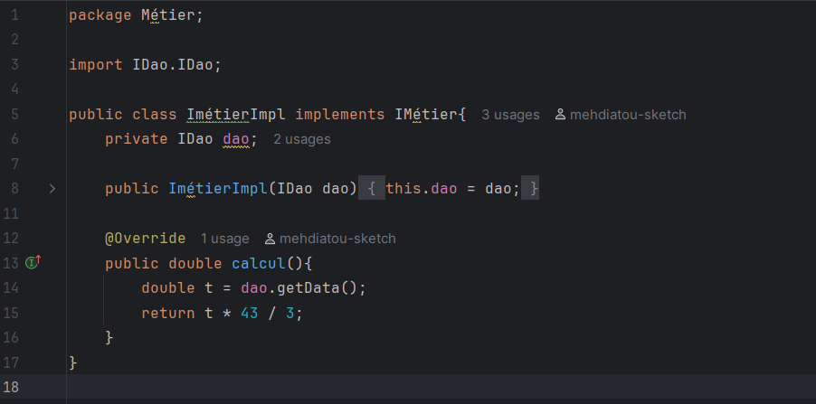
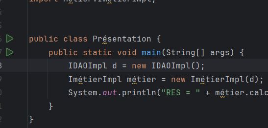

<h3>Compte Rendu:</h3>
    
Créer l'interface IDao avec une méthode getData

    
    
Créer une implémentation de cette interface

    
Implémentation IDAO 1:
 
     
    
Implémentation IDAO 2:
 
     
    
Créer l'interface IMetier avec une méthode calcul

    
    
Créer une implémentation de cette interface en utilisant le couplage faible

    
    
Faire l'injection des dépendances :
        <ol>
            <li>Par instanciation statique (provide evidence)</li>
            <li>Par instanciation dynamique (provide evidence)</li>
            <li>En utilisant le Framework Spring:
                <ul>
                    <li>Version XML (provide evidence)</li>
                    <li>Version Annotations (provide evidence)</li>
                </ul>
            </li>
        </ol>
    

